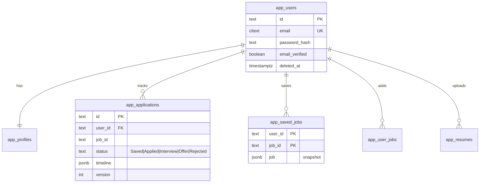

# Jobora database design

## Today vs target

| | Today (`0003_jobora_kv_store.sql`) | Target (`0004_relational_app_schema.sql`) |
|---|---|---|
| Shape | One `jobora_kv` table, one JSON document per key | Six typed tables with foreign keys |
| Code change | Small: stores write through to Supabase | Larger: routes query tables directly |
| Queries across users | Not practical | Normal SQL (counts, reports) |
| Integrity | App code only | Constraints, `UNIQUE (user_id, job_id)`, status `CHECK` |

The key-value table fixes the urgent bug (accounts lost between serverless
instances) with the least code change. The relational schema is where the data
should live long term; migrate when reporting, admin tools or analytics are needed.

## Why 0001/0002 are not used

They were written for Supabase Auth (`auth.users`, `auth.uid()` in RLS).
Jobora authenticates users itself with bcrypt and its own JWT, and user ids are
text (`user-<time>-<random>`), so those foreign keys and policies can never match.

## Access model

The Next.js server is the only database client and uses the **secret** key,
which bypasses RLS. Every table has RLS enabled with **no policies**, and
`anon`/`authenticated` have no grants, so the publishable key that ships to
browsers can read and write nothing.

## Entity relationships

## Decisions

- **Text ids, not UUIDs:** matches the ids already issued in session tokens.
- **`citext` email:** case-insensitive uniqueness without lower() everywhere.
- **Saved jobs store a JSON snapshot:** live listings vanish from boards, and a
  saved role must still open.
- **`timeline` as JSONB on the application:** always read with the row, never
  queried on its own.
- **`version` on applications:** lets the board reject a stale drag (optimistic locking).
- **Indexes** follow the only access paths the app uses: by user, newest first;
  applications also by status for the board.
